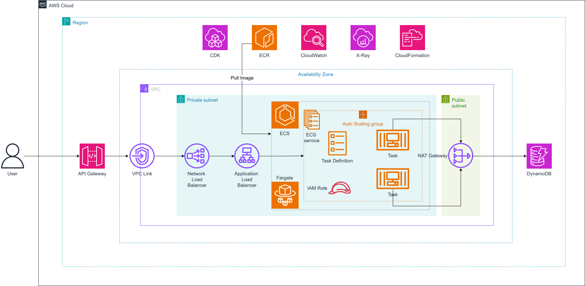

# Triển khai Spring Boot lên ECS Fargate bằng AWS CDK TypeScript

Bài lab này hướng dẫn cách đóng gói một ứng dụng Spring Boot thành Docker image, lưu image vào Amazon ECR và dùng AWS CDK viết bằng TypeScript để tạo hạ tầng chạy ứng dụng trên Amazon ECS Fargate.

Trong suốt bài lab, CloudFormation sẽ thực thi các template do CDK sinh ra. Ứng dụng chạy trong Fargate task ở private subnet, được truy cập qua internal Application Load Balancer, Network Load Balancer và API Gateway HTTP API thông qua VPC Link.

Luồng chính của hệ thống là: ứng dụng Spring Boot được đóng gói thành image, image được push lên ECR, CDK tạo VPC/ECS/DynamoDB/API Gateway, ECS pull image và chạy task, sau đó request đi từ API Gateway qua VPC Link, NLB và ALB tới Spring Boot.

Bài lab được viết theo repository IaC-ECS-CDK hiện tại, sử dụng Maven cho Spring Boot và TypeScript cho CDK. Hãy đi theo thứ tự các mục trong thanh điều hướng và luôn kiểm tra bước local trước khi deploy lên AWS.

